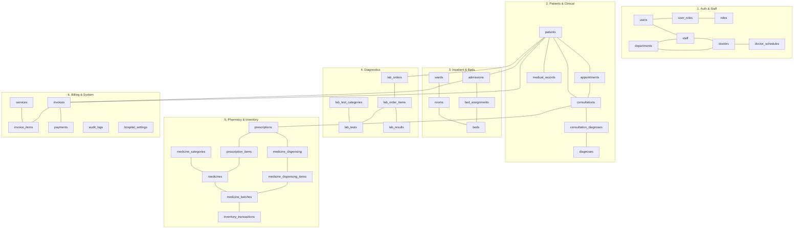

# 🏥 Apex Hospital Management System (HMS)
## Complete Project Documentation & Technical Architecture Specification

---

## Executive Summary

The **Apex Hospital Management System (HMS)** is an enterprise-grade, database-centric healthcare management solution engineered for clinical, administrative, inventory, and financial operations. 

Unlike traditional modern web applications that abstract database management behind Object-Relational Mappers (ORMs) or query builders, Apex HMS enforces operational business logic, referential constraints, transaction safety, concurrency control, and audit logging **directly inside PostgreSQL 18** using ANSI-compliant Structured Query Language (SQL) and Procedural Language (PL/pgSQL).

### Key System Metrics
* **Architectural Model:** 3-Tier Client-Server Architecture (React 19 SPA + Express.js API + PostgreSQL 18 DB)
* **ORM Usage:** **0% (Zero ORM)**. 100% Parameterized Raw SQL with the plain Node `pg` driver.
* **Database Entities:** **37 Normalized Relational Tables** in strict **Third Normal Form (3NF)**.
* **Database Logic:** **7 Active Database Triggers**, **4 Stored Procedures**, **4 Scalar/Table Functions**.
* **Synthetic Dataset:** Over **14,000 realistic interconnected records** generated via high-speed asynchronous data seeds.
* **Frontend Modules:** **18 fully functional interactive views** built with React 19 and modern responsive CSS.
* **Security & Access Control:** Dual-layer Role-Based Access Control (Application-level JWT + PostgreSQL Database Roles).

---

## 1. Project Directory & Repository Structure

```text
hospital-management-system/
├── .env.example                                # Database & server environment template
├── .gitignore                                  # Git exclusion configuration
├── package.json                                # Root workspace orchestration scripts
├── package-lock.json                           # Dependency lockfile
├── README.md                                   # Quickstart guide & academic highlights
│
├── schema/                                     # Database DDL & Structural Definitions
│   ├── 01_create_tables.sql                    # 37 relational tables with sequences & constraints
│   ├── 02_constraints.sql                      # Foreign keys, uniqueness rules & CHECK constraints
│   ├── 03_indexes.sql                          # Primary, composite, foreign key & partial B-Tree indexes
│   ├── 04_views.sql                            # Operational reporting views & materialized views
│   └── 05_roles_and_privileges.sql             # PostgreSQL native RBAC roles & privilege grants
│
├── routines/                                   # Database-Level Business Logic (PL/pgSQL)
│   ├── functions.sql                           # Computational & table-valued functions
│   ├── procedures.sql                          # Multi-table atomic transactional stored procedures
│   └── triggers.sql                            # BEFORE/AFTER triggers & JSONB audit capture
│
├── queries/                                    # Reference Query Catalog
│   ├── insert_queries.sql                      # Transactional insert query templates
│   ├── update_queries.sql                      # State update queries
│   ├── delete_queries.sql                      # Soft-deletion and referential cascading scripts
│   ├── advanced_queries.sql                    # Multi-table JOINs, aggregations & subqueries
│   └── reporting_queries.sql                   # Clinical, operational, and financial KPI queries
│
├── seed/                                       # Data Seeding & High-Volume Generation
│   ├── 01_reference_data.sql                   # Standard departments, diagnoses, lab tests, medicines
│   ├── 02_sample_data.sql                      # Staff profiles, user accounts, and test schedules
│   └── generate_data.js                        # High-speed synthetic data generator (~14,000 rows)
│
├── backend/                                    # Node.js / Express.js REST API Layer
│   ├── src/
│   │   ├── db/
│   │   │   └── pool.js                         # Parameterized PostgreSQL connection pool
│   │   ├── middleware/
│   │   │   ├── auth.middleware.js              # JWT validation & role claims inspection
│   │   │   └── error.middleware.js             # Centralized error handler & transaction rollback
│   │   ├── routes/                             # 15 Modular REST API Routers
│   │   │   ├── admissions.routes.js            # Inpatient admission, bed allocation & discharge
│   │   │   ├── appointments.routes.js          # Appointment scheduling & conflict checks
│   │   │   ├── audit.routes.js                 # System-wide audit log queries & inspection
│   │   │   ├── auth.routes.js                  # User login, authentication & token issue
│   │   │   ├── billing.routes.js               # Invoices, itemization & payment processing
│   │   │   ├── consultations.routes.js         # Clinical encounters, diagnoses & vital signs
│   │   │   ├── departments.routes.js           # Department directory & head physicians
│   │   │   ├── doctors.routes.js               # Physician credentials, schedules & availability
│   │   │   ├── laboratory.routes.js            # Diagnostic test orders, requisitions & results
│   │   │   ├── patients.routes.js              # Patient registration, records & balance summaries
│   │   │   ├── pharmacy.routes.js              # Drug formulary, batches & inventory stock ledger
│   │   │   ├── prescriptions.routes.js         # Medication orders & pharmacy fulfillment
│   │   │   ├── reports.routes.js               # Financial, clinical & operational KPIs
│   │   │   ├── staff.routes.js                 # Hospital personnel & user account links
│   │   │   └── wards.routes.js                 # Inpatient wards, rooms & bed status
│   │   └── app.js                              # Express app bootstrap, CORS & route mounting
│   ├── .env                                    # Active backend environment variables
│   └── package.json                            # Backend dependencies & startup scripts
│
├── frontend/                                   # React 19 + Vite Single-Page Application
│   ├── src/
│   │   ├── components/                         # Shared UI Components
│   │   │   ├── Navbar.jsx                      # App navigation bar with active user role badge
│   │   │   ├── Sidebar.jsx                     # Collapsible sidebar with role-aware menu filtering
│   │   │   ├── DataTable.jsx                   # Reusable searchable/paginated data grid
│   │   │   └── Modal.jsx                       # Accessible dialog modal for forms & inspection
│   │   ├── pages/                              # 18 Fully Functional Module Pages
│   │   │   ├── AdmissionsPage.jsx              # Inpatient admission tracking & discharge
│   │   │   ├── AppointmentsPage.jsx            # Calendar & tabular appointment scheduling
│   │   │   ├── AuditLogsPage.jsx               # System change history (JSONB diff inspection)
│   │   │   ├── BillingPage.jsx                 # Patient invoices & fee breakdown
│   │   │   ├── ConsultationsPage.jsx           # Clinical encounter records & vitals entry
│   │   │   ├── DashboardPage.jsx               # Overview metrics, charts & quick-action hub
│   │   │   ├── DepartmentsPage.jsx             # Hospital departments directory
│   │   │   ├── DoctorsPage.jsx                 # Doctor directory, licenses & schedules
│   │   │   ├── LaboratoryPage.jsx              # Lab requisitions, test entry & result flags
│   │   │   ├── LoginPage.jsx                   # Authentication portal with 1-click role switches
│   │   │   ├── PatientsPage.jsx                # Patient registry & clinical history modal
│   │   │   ├── PaymentsPage.jsx                # Transaction receipts & payment history
│   │   │   ├── PharmacyPage.jsx                # Inventory batches & low-stock alerts
│   │   │   ├── PrescriptionsPage.jsx           # Prescribed medications & dispensing status
│   │   │   ├── ReportsPage.jsx                 # Operational analytics & EXPLAIN ANALYZE tool
│   │   │   ├── SettingsPage.jsx                # Hospital system configuration parameters
│   │   │   ├── StaffPage.jsx                   # Personnel management & role assignments
│   │   │   └── WardsPage.jsx                   # Bed management & ward layout visualization
│   │   ├── services/
│   │   │   └── api.js                          # Axios-equivalent fetch wrapper with JWT interceptor
│   │   ├── App.jsx                             # Application router, role guards & state
│   │   ├── index.css                           # Modern healthcare design system
│   │   └── main.jsx                            # React 19 DOM entrypoint
│   ├── vite.config.js                          # Vite build tool and reverse proxy configuration
│   └── package.json                            # Frontend dependencies (React 19, Lucide icons)
│
├── tests/                                      # Verification & Quality Assurance Suites
│   ├── database_tests.sql                      # SQL test script validating constraints & triggers
│   ├── transaction_tests.sql                   # Transaction atomicity and rollback verification
│   └── api_tests/
│       └── workflows.test.js                   # End-to-end integration test suite (Workflows A-F)
│
└── docs/                                       # Architectural & Defense Documentation
    ├── ERD.svg                                 # Rendered visual Entity-Relationship Diagram
    ├── ERD_source                              # Mermaid code for Entity-Relationship Diagram
    ├── data_dictionary.md                      # Complete 3NF proofs, data types, and column constraints
    ├── viva_guide.md                           # University defense and examiner Q&A handbook
    └── PROJECT_DOCUMENTATION.md                # Comprehensive system documentation
```

---

## 2. Key Stakeholders & Role-Based Access Matrix

The system features **7 primary functional roles** alongside the patient end-beneficiary and compliance auditing entities.

| Stakeholder Role | Primary Responsibilities | Database Role | Frontend Scope & Permitted Pages |
| :--- | :--- | :--- | :--- |
| **1. Hospital Administrator** | Executive hospital administration, staff onboarding, department administration, tariff governance, global system settings, database inspection, audit trail review, and materialized view refresh. | `hms_admin` | Full access across all 18 modules (Dashboard, Patients, Doctors, Staff, Departments, Appointments, Consultations, Admissions, Wards, Lab, Pharmacy, Prescriptions, Billing, Payments, Reports, Audit Logs, Settings). |
| **2. Doctor / Physician** | Outpatient clinic encounters, medical diagnosis entry (ICD-10 classification), vital sign recording, electronic prescription authoring, ordering diagnostic laboratory tests, inpatient admission requests, and reviewing clinical history. | `hms_doctor` | Dashboard, Patients (Read), Appointments, Consultations, Prescriptions (Create/View), Laboratory (Order/Review), Admissions (View). |
| **3. Nurse / Ward Manager** | Inpatient ward oversight, bed availability tracking, room assignment, patient admission processing, vital signs recording, ward transfers, and inpatient discharge preparation. | `hms_nurse` | Dashboard, Patients (Read), Wards & Beds, Admissions, Consultations (Vitals Read/Update). |
| **4. Receptionist / Front Desk** | Patient demographic registration, outpatient appointment booking, schedule lookup, appointment cancellations/rescheduling, patient queue coordination, and bed vacancy inquiry. | `hms_receptionist` | Dashboard, Patients (Create/Update), Appointments (Full Management), Doctors (Schedule View), Wards (Bed Availability Inquiry). |
| **5. Pharmacist** | Drug formulary management, stock batch tracking, expiry date monitoring, low-stock reorder thresholds, inventory restocking, prescription validation, and medicine dispensing. | `hms_pharmacist` | Dashboard, Pharmacy (Inventory & Batches), Prescriptions (Dispensing Fulfillment), Patients (Read). |
| **6. Laboratory Technician** | Diagnostic test catalog maintenance, test requisition intake, specimen collection, test execution, recording numeric/qualitative results, reference range comparison, and abnormal value flagging. | `hms_labtech` | Dashboard, Laboratory (Requisitions, Tests & Results), Patients (Read), Consultations (Read). |
| **7. Accountant / Cashier** | Tariff fee scheduling, itemized invoice generation (combining consults, bed stay, pharmacy, lab tests), discount and tax application, payment receipt issuance, payment reconciliations, and financial reporting. | `hms_accountant` | Dashboard, Billing (Invoices & Items), Payments (Receipt Processing), Services/Tariffs, Reports (Financial & Revenue). |
| **8. Patient (Subject / Debtor)** | The patient is the central clinical subject. Master medical records, appointment schedules, prescriptions, lab results, and financial invoices are linked to their unique `patient_code`. | *Application Subject* | Data access through front-desk staff, billing statements, and prescription receipts. |
| **9. System Auditor / Compliance Officer** | Regulatory oversight, tamper detection, data protection verification, and tracking historical mutations across tables via before/after JSONB change-data-capture logs. | `hms_admin` | Audit Logs viewer, System Activity Logs, Transaction History. |

---

## 3. Comprehensive Feature Catalog

### 3.1 Authentication & Security Governance
* **Dual-Layer Access Control:** Combines Express-level JSON Web Tokens (JWT) with native PostgreSQL database roles (`hms_admin`, `hms_doctor`, `hms_nurse`, `hms_receptionist`, `hms_pharmacist`, `hms_labtech`, `hms_accountant`).
* **Cryptographic Password Storage:** Passwords hashed using standard `bcrypt` with salt rounds.
* **1-Click Viva Quick-Login:** Quick-login selector on the login portal for effortless role-switching during demonstrations.
* **Centralized JSONB Audit Logging:** Automatically logs all `INSERT`, `UPDATE`, and `DELETE` operations on core tables (`patients`, `appointments`, `invoices`, `admissions`) capturing `OLD` and `NEW` row snapshots, user ID, and timestamp.

### 3.2 Patient Demographics & Master Records
* **Universal Patient Registry:** Tracks personal data, national identity, DOB, gender, blood group, emergency contact details, and contact information.
* **Unique Patient Identifier:** Automated business code generation (`P-10001`) with index-backed uniqueness.
* **Comprehensive Clinical History Modal:** Outpatient consultations, historical vitals, inpatient hospital admissions, diagnostic laboratory results, and prescription records unified under each patient.
* **Real-time Balance Due Indicator:** Invokes PL/pgSQL function `fn_calculate_patient_balance(patient_id)` to display outstanding financial obligations dynamically.

### 3.3 Outpatient Appointment Scheduling
* **Doctor Weekly Availability Templates:** Configurable clinic shifts, start/end times, slot durations (e.g., 20 minutes), and maximum patient capacity per shift.
* **Automated Schedule Conflict Prevention:** Enforced at the database engine level via `trg_check_appointment_conflict`. Rejects overlapping appointments for the same doctor with an SQL exception.
* **Appointment Lifecycle Management:** Tracks lifecycle states: `Scheduled` ➔ `Confirmed` ➔ `Completed` / `Cancelled` / `No-Show`.

### 3.4 Clinical Consultations & Electronic Medical Records (EMR)
* **Clinical Encounter Documentation:** Structured capture of presenting symptoms, doctor clinical findings, examination notes, and follow-up recommendations.
* **JSONB Vital Signs Storage:** Stores semi-structured clinical vitals:
  ```json
  {
    "bp_systolic": 120,
    "bp_diastolic": 80,
    "pulse": 72,
    "temp_f": 98.6,
    "weight_kg": 70,
    "spo2": 99
  }
  ```
* **ICD-10 Diagnostic Coding:** Normalized many-to-many relationship linking consultations to standardized diagnostic classifications (`consultation_diagnoses` ➔ `diagnoses`) with categorization (`Primary`, `Secondary`, `Differential`).

### 3.5 Inpatient Admissions & Ward/Bed Management
* **Hierarchical Facility Structure:** Wards ➔ Rooms ➔ Beds.
* **Live Occupancy Status:** Beds reflect statuses: `Available`, `Occupied`, `Maintenance`, `Reserved`.
* **Atomic Admission Procedure (`sp_admit_patient`):** 
  - Validates bed availability.
  - Generates admission number (`ADM-2026-XXXX`).
  - Creates active bed assignment record.
  - Updates bed status to `Occupied` within an atomic transaction.
* **Automated Discharge & Billing Procedure (`sp_discharge_patient`):**
  - Releases bed status back to `Available`.
  - Calculates length of hospital stay (days).
  - Automatically generates an itemized inpatient invoice factoring bed daily rates.

### 3.6 Diagnostic Laboratory Management
* **Comprehensive Test Catalog:** Categorized tests (Hematology, Biochemistry, Microbiology, Radiology) with standard fees, units, reference ranges, and sample types (`Blood`, `Urine`, `Serum`, etc.).
* **Doctor Diagnostic Requisitions:** Multi-test lab orders linked to patient encounters with priorities (`Routine`, `Urgent`, `Emergency`).
* **Test Parameter Measurement & Out-of-Bounds Flagging:** Records measured values against baseline normal ranges and sets `is_abnormal = TRUE` for abnormal findings.
* **Physician Verification:** Tracks technician execution and physician/pathologist verification.

### 3.7 Pharmacy Formulary, Multi-Batch Inventory & Dispensing
* **Drug Formulary Catalog:** Brand names, generic active ingredients, therapeutic categories, dosage forms, concentrations, and manufacturer info.
* **Multi-Batch Inventory Tracking:** Tracks physical lots with batch numbers, manufacturing dates, expiry dates, acquisition cost, and retail selling price.
* **Automated Negative-Stock Prevention (`trg_inventory_stock_control`):** Rejects any dispensing attempt exceeding the physical stock of the selected batch.
* **Double-Entry Inventory Ledger:** All movements (Purchase, Dispense, Adjustment, Return, Disposal) documented in `inventory_transactions`.
* **Digital Prescription Fulfillment:** Pharmacists fulfill doctor prescriptions item-by-item, tracking dispensed quantities against prescribed quantities.

### 3.8 Itemized Billing, Fee Tariffs & Payment Processing
* **Standard Tariff Schedule:** Master fee rates for consultations, lab tests, bed-day rates, surgical procedures, and nursing care.
* **Multi-Source Invoicing:** Invoices aggregate charges from outpatient consultations, inpatient stays, pharmacy dispensing, and laboratory requisitions.
* **Transactional Payment Stored Procedure (`sp_process_payment`):**
  - Locks invoice row using PostgreSQL `FOR UPDATE`.
  - Validates payment amount against remaining balance due.
  - Inserts payment receipt with payment method (Cash, Credit Card, Debit Card, MFS/bKash, Bank Transfer, Insurance).
  - Invokes trigger `trg_recalculate_invoice_balance` to update total paid and set invoice status to `Paid` or `Partially Paid`.

### 3.9 Executive Analytics, Materialized Views & Query Plan Inspector
* **Financial & Clinical KPIs:** Real-time metrics on total revenue, monthly collections, occupancy rates, doctor workload, and department earnings.
* **Materialized View Caching:** High-volume summary statistics cached in `mv_monthly_hospital_performance`, refreshed via stored procedure `sp_generate_monthly_hospital_report`.
* **Live EXPLAIN ANALYZE Query Plan Inspector:** Interactive query visualizer embedded directly in the Reports view allowing live performance analysis of B-Tree index scans, partial indexes, planning times, execution times, and buffer hit rates.

---

## 4. Database Schema Architecture (37 Relational Tables)

The database schema is organized into **6 relational clusters**, adhering strictly to **Third Normal Form (3NF)**:



### Table Inventory by Cluster

| Cluster | Table Name | Primary Key | Description |
| :--- | :--- | :--- | :--- |
| **1. Auth & Organization** | `roles` | `role_id` | Master user roles (Admin, Doctor, Nurse, etc.) |
| | `users` | `user_id` | User login accounts & bcrypt password hashes |
| | `user_roles` | `(user_id, role_id)` | Composite junction mapping users to multiple roles |
| | `departments` | `department_id` | Medical departments (Cardiology, Neurology, etc.) |
| | `staff` | `staff_id` | Personnel demographic & employment details |
| | `doctors` | `doctor_id` | Physician medical licenses, fees & specialties |
| | `doctor_schedules` | `schedule_id` | Weekly availability shift templates |
| **2. Patients & Clinical** | `patients` | `patient_id` | Master patient demographic registry |
| | `appointments` | `appointment_id` | Outpatient booking appointments |
| | `consultations` | `consultation_id` | Doctor encounter notes & JSONB vitals |
| | `diagnoses` | `diagnosis_id` | ICD-10 standardized diagnostic disease catalog |
| | `consultation_diagnoses`| `(consultation_id, diagnosis_id)` | Composite junction linking encounters to diagnoses |
| | `medical_records` | `record_id` | External clinical files, imaging, and reports |
| **3. Inpatient & Beds** | `wards` | `ward_id` | Hospital inpatient care wards |
| | `rooms` | `room_id` | Rooms located inside wards |
| | `beds` | `bed_id` | Individual beds with daily tariff rates & status |
| | `admissions` | `admission_id` | Inpatient hospital admission stays |
| | `bed_assignments` | `assignment_id` | Historical & active bed allocation events |
| **4. Diagnostic Lab** | `lab_test_categories` | `category_id` | Diagnostic test classifications |
| | `lab_tests` | `test_id` | Master catalog of lab tests, fees & baseline ranges |
| | `lab_orders` | `order_id` | Doctor diagnostic test requisition batches |
| | `lab_order_items` | `order_item_id` | Line items for specific tests requested |
| | `lab_results` | `result_id` | Quantitative measured findings & abnormal flags |
| **5. Pharmacy & Stock** | `medicine_categories` | `category_id` | Pharmacological drug therapeutic categories |
| | `medicines` | `medicine_id` | Master pharmaceutical drug formulary |
| | `medicine_batches` | `batch_id` | Inventory lots with expiry dates & physical stock |
| | `inventory_transactions`| `transaction_id` | Double-entry stock movements ledger |
| | `prescriptions` | `prescription_id` | Doctor prescription orders |
| | `prescription_items` | `item_id` | Line items specifying drugs, dosages & duration |
| | `medicine_dispensing` | `dispensing_id` | Pharmacy checkout header documentation |
| | `medicine_dispensing_items` | `dispensing_item_id` | Dispensed items detailing batch lots pulled |
| **6. Billing & System** | `services` | `service_id` | Standard hospital procedure and care tariff catalog |
| | `invoices` | `invoice_id` | Consolidated billing invoice statements |
| | `invoice_items` | `item_id` | Itemized charges linked to specific clinical acts |
| | `payments` | `payment_id` | Financial remittances & payment receipts |
| | `audit_logs` | `log_id` | JSONB change-data-capture audit log trail |
| | `hospital_settings` | `setting_key` | Key-value system configuration store |

---

## 5. Database Logic: Routines, Triggers & Procedures

### 5.1 Active Database Triggers (7 Triggers)
1. **`trg_users_updated_at` (`BEFORE UPDATE`):** Automatically sets `updated_at = CURRENT_TIMESTAMP` across master entities.
2. **`trg_check_appointment_conflict` (`BEFORE INSERT OR UPDATE` ON `appointments`):** Prevents double-booking doctors by checking overlapping time windows (`start_time < NEW.end_time AND end_time > NEW.start_time`) for the same doctor on that date. Raises SQL exception on collision.
3. **`trg_validate_bed_assignment` (`BEFORE INSERT` ON `bed_assignments`):** Validates that the requested bed has status `Available` and is not already assigned to another active admission.
4. **`trg_sync_bed_status` (`AFTER INSERT OR UPDATE` ON `bed_assignments`):** Automatically sets `beds.status = 'Occupied'` when an active bed assignment is made, and reverts it to `'Available'` when released.
5. **`trg_inventory_stock_control` (`BEFORE INSERT` ON `inventory_transactions`):** Synchronizes `medicine_batches.current_quantity`. Prevents negative inventory by raising an exception if deduction exceeds batch stock.
6. **`trg_recalculate_invoice_balance` (`AFTER INSERT OR UPDATE` ON `payments`):** Automatically recalculates total payments against the parent invoice, balances due, and sets invoice status to `Paid` or `Partially Paid`.
7. **`trg_audit_patients` / `appointments` (`AFTER INSERT OR UPDATE OR DELETE`):** Writes JSONB snapshots of `to_jsonb(OLD)` and `to_jsonb(NEW)` to `audit_logs`.

### 5.2 Multi-Table Atomic Stored Procedures (4 Procedures)
1. **`sp_admit_patient(p_patient_id, p_doctor_id, p_bed_id, p_reason, p_user_id, INOUT p_admission_id)`:** Adopts an atomic transaction to create an admission record, reserve the specified bed, and create the active bed assignment.
2. **`sp_discharge_patient(p_admission_id, p_summary, p_user_id, INOUT p_invoice_id)`:** Records discharge timestamps, frees the bed back to `Available`, calculates total inpatient stay days, and automatically generates an itemized inpatient invoice.
3. **`sp_process_payment(p_invoice_id, p_amount, p_method, p_ref, p_user_id, INOUT p_payment_id)`:** Uses `SELECT ... FOR UPDATE` row locking to eliminate payment race conditions, records the receipt, and recalculates balances.
4. **`sp_generate_monthly_hospital_report(p_target_month)`:** Aggregates monthly cross-cluster performance and performs `REFRESH MATERIALIZED VIEW mv_monthly_hospital_performance`.

### 5.3 Database Functions (4 PL/pgSQL Functions)
1. **`fn_calculate_patient_balance(p_patient_id)` ➔ `NUMERIC(12,2)`:** Computes net unpaid balances across all active invoices for a given patient.
2. **`fn_get_available_beds(p_ward_id)` ➔ `TABLE(...)`:** Queries vacant beds leveraging the partial index `idx_beds_available`.
3. **`fn_calculate_invoice_total(p_invoice_id)` ➔ `NUMERIC(12,2)`:** Recomputes gross totals, discounts, and tax amounts for an invoice.
4. **`fn_check_doctor_availability(p_doctor_id, p_date, p_start, p_end)` ➔ `BOOLEAN`:** Evaluates physician schedule conflicts in real time.

---

## 6. End-to-End Operational Workflows

```text
[ Workflow A: Outpatient Journey ]
Patient Registration ➔ Book Appointment (Conflict Checked) ➔ Clinical Consultation (Vitals + Diagnoses) ➔ Generate Prescription ➔ Itemized Invoicing

[ Workflow B: Inpatient Admission to Discharge ]
Admission Request ➔ Bed Allocation (sp_admit_patient) ➔ Inpatient Stay ➔ Discharge (sp_discharge_patient) ➔ Bed Reverted to Available ➔ Auto Inpatient Invoice

[ Workflow C: Diagnostic Requisition Loop ]
Doctor Orders Lab Tests ➔ Specimen Collection ➔ Technician Runs Tests & Enters Results ➔ Normal Range Check ➔ Physician Verification ➔ Lab Fee Added to Invoice

[ Workflow D: Pharmacy Dispensing Loop ]
Doctor Issues Prescription ➔ Pharmacist Validates Stock ➔ Dispense Items ➔ trg_inventory_stock_control Checks Batch Qty ➔ Stock Deducted ➔ Inventory Ledger Logged

[ Workflow E: Financial Billing & Settlement ]
Clinical Charges Consolidated ➔ Invoice Generated ➔ Cashier Records Payment (sp_process_payment) ➔ Row Locked FOR UPDATE ➔ Balance Rebalanced (Paid / Partially Paid)

[ Workflow F: Governance & Audit Trail ]
Any Clinical / Financial Mutation ➔ Database Triggers Fire ➔ JSONB Pre/Post Delta Written to audit_logs ➔ Administrator Reviews in Audit Portal
```

---

## 7. Installation, Setup & Verification Guide

### 7.1 System Prerequisites
* **Node.js** (v18.0.0 or higher)
* **PostgreSQL** (v15+ recommended, tested on PostgreSQL 18)

### 7.2 Database Setup
Execute in PostgreSQL command line or pgAdmin:
```bash
createdb -U postgres hospital_db

# Foundations & Schema (DDL)
psql -U postgres -d hospital_db -f schema/01_create_tables.sql
psql -U postgres -d hospital_db -f schema/02_constraints.sql
psql -U postgres -d hospital_db -f schema/03_indexes.sql
psql -U postgres -d hospital_db -f schema/04_views.sql
psql -U postgres -d hospital_db -f schema/05_roles_and_privileges.sql

# PL/pgSQL Business Logic & Routines
psql -U postgres -d hospital_db -f routines/functions.sql
psql -U postgres -d hospital_db -f routines/procedures.sql
psql -U postgres -d hospital_db -f routines/triggers.sql

# Reference Master Data
psql -U postgres -d hospital_db -f seed/01_reference_data.sql
```

### 7.3 High-Speed Synthetic Seeding (~14,000 Records)
Populate all 37 tables with realistic clinical data:
```bash
node seed/generate_data.js
```
*(Executes in ~7 seconds, creating 1,500 patients, 30 doctors, 3,000 appointments, 2,000 consultations, 300 admissions, 1,000 prescriptions, 2,000 invoices, and 3,000 payments).*

### 7.4 Service Execution
Start Backend (Port 5000):
```bash
cd backend
npm install
npm start
```

Start Frontend (Port 3000):
```bash
cd frontend
npm install
npm run dev
```

Or start both concurrently from the project root:
```bash
npm run dev
```

### 7.5 Automated Verification Suites
Run the end-to-end integration test suite verifying Workflows A-F:
```bash
node tests/api_tests/workflows.test.js
```

Run database-level constraint and rollback verification:
```bash
psql -U postgres -d hospital_db -f tests/database_tests.sql
psql -U postgres -d hospital_db -f tests/transaction_tests.sql
```

---

## 8. Demo User Accounts for University Examination & Evaluation

| Role | Username | Password | Key Viva Scenarios to Evaluate |
| :--- | :--- | :--- | :--- |
| **Administrator** | `admin` | `password123` | Full dashboard access, EXPLAIN ANALYZE visualizer, audit log inspection, staff onboarding. |
| **Doctor** | `doctor1` | `password123` | Outpatient encounters, symptom recording, ICD-10 diagnostic tagging, e-prescriptions. |
| **Nurse** | `nurse1` | `password123` | Ward layout visualizer, bed allocation, inpatient admissions, patient vitals. |
| **Receptionist** | `receptionist1` | `password123` | Patient demographic entry, appointment booking, trigger-enforced schedule conflict test. |
| **Pharmacist** | `pharmacist1` | `password123` | Batch inventory inspection, stock expiry alerts, prescription dispensing & negative stock test. |
| **Lab Technician** | `labtech1` | `password123` | Diagnostic test requisitions, specimen entry, parameter results & abnormal value flags. |
| **Accountant** | `accountant1` | `password123` | Multi-source itemized invoice generation, payment processing (`FOR UPDATE`), balance trigger. |
